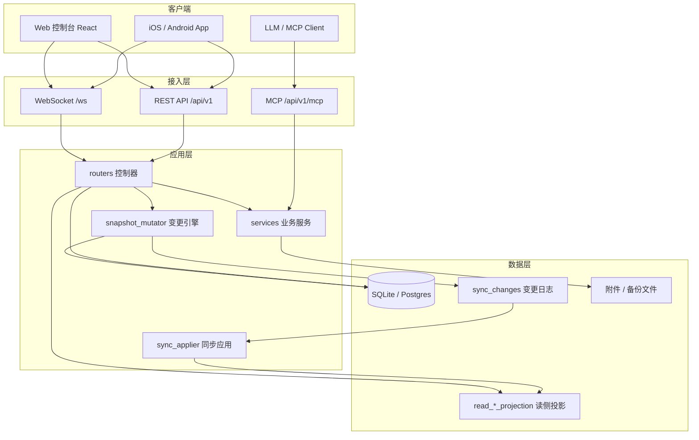

# BeeCount Cloud — 项目开发文档

> 面向后端 / 前端 / 客户端开发者的权威技术文档。涵盖架构、目录、API、数据模型、同步、认证、构建、测试与部署。
> 专题文档见文末「文档索引」。
>
> **二次开发**：本仓库在本地副本上做了大量定制（功能编号 0022–0058、19 个新增迁移、7 大业务域）。
> 这部分内容集中记录在 [`SECONDARY_DEVELOPMENT.md`](./SECONDARY_DEVELOPMENT.md)，开发与维护时请一并查阅。

---

## 目录

1. [项目概述](#1-项目概述)
2. [快速开始](#2-快速开始)
3. [仓库结构](#3-仓库结构)
4. [系统架构](#4-系统架构)
5. [后端开发](#5-后端开发)
6. [前端开发](#6-前端开发)
7. [API 约定](#7-api-约定)
8. [数据模型](#8-数据模型)
9. [同步机制](#9-同步机制)
10. [认证与授权](#10-认证与授权)
11. [MCP 与 AI](#11-mcp-与-ai)
12. [测试策略](#12-测试策略)
13. [部署与运维](#13-部署与运维)
14. [开发约定与常见陷阱](#14-开发约定与常见陷阱)
15. [文档索引](#15-文档索引)

---

## 1. 项目概述

- **定位**：BeeCount（蜜蜂记账）iOS/Android App 的自部署同步云端，三端共用一份账本；无广告、无订阅、无第三方依赖。
- **形态**：FastAPI 单体后端 + React Web 控制台 + WebSocket 实时同步 + MCP Server（LLM 自然语言记账）。
- **许可证**：BSL（Business Source License）。
- **多语言**：简体中文 / 繁體中文 / English。
- **当前版本**：`src/version.py`（`APP_VERSION` 环境变量，缺省 `1.0.0`）。

### 技术栈

| 层 | 技术 |
|---|---|
| 后端 | Python 3.11+ · FastAPI · SQLAlchemy 2.0（Mapped/mapped_column）· Pydantic-settings · Alembic · SQLite / PostgreSQL · PyJWT · passlib |
| 前端 | React 18 · Vite 5 · TypeScript 5.5 · TailwindCSS 3.4 · Radix UI · pnpm 10 monorepo |
| 实时 | WebSocket（`WSConnectionManager`）· SSE（AI 问答） |
| AI | FastMCP（Streamable HTTP）· RAG（sqlite + numpy 内存索引）· OpenAI-compatible LLM |
| 测试 | pytest · Vitest 2.1 · Playwright（E2E 脚本在 `scripts/qa/`） |
| 运维 | Docker Compose · APScheduler（备份/调度）· Prometheus metrics · rclone 备份 |

代码规模：`src/` 约 2.5 万行 Python；48 张数据库表；26 个 router 挂载 + 1 个 MCP 精确路由；前端 27 个页面、17 个单测文件。

---

## 2. 快速开始

### 环境要求

- 后端：Python 3.11+，pip/venv
- 前端：Node.js 22+，pnpm 10+
- 数据库：SQLite（默认，零配置）或 PostgreSQL（可选）

### 启动

```bash
# ===== 后端 =====
cd BeeCount-Cloud
python -m venv .venv && . .venv/bin/activate
pip install -r requirements.txt
alembic upgrade head
uvicorn server:app --port 8080 --reload

# ===== 前端 =====
cd frontend
pnpm install
pnpm -C apps/web dev        # http://127.0.0.1:5173
```

- 前端 Vite 已配置代理：`/api` → `http://127.0.0.1:8080`，本地开发无需处理 CORS。
- 一键脚本：`scripts/dev_up.sh`（自动 alembic + 起后端 + 起前端，需 pnpm）。
- 服务地址：后端 `http://127.0.0.1:8080`，Swagger `/docs`，OpenAPI `/openapi.json`。

### 默认管理员

数据库为空时 `ensure_admin()` 幂等创建 admin，初始密码写入 `/data/.initial_admin_password`。

---

## 3. 仓库结构

```
BeeCount-Cloud/
├── server.py               # uvicorn 入口（import server:app）
├── src/                    # 后端
│   ├── main.py             # FastAPI 实例、router 注册、middleware、startup/shutdown
│   ├── config.py           # Settings（pydantic-settings，lru_cache）
│   ├── models.py           # 48 张 SQLAlchemy 表
│   ├── schemas*.py         # Pydantic 契约（schemas / schemas_cl / _sp / _rb / _dep ...）
│   ├── security.py         # JWT / 密码哈希 / PAT / TOTP 哈希
│   ├── deps.py             # 依赖注入（scope / 用户 / 账本角色 / MCP 分流）
│   ├── ledger_access.py    # 账本成员授权
│   ├── projection.py       # CQRS 读侧投影写入
│   ├── snapshot_*.py       # snapshot 构建/变更/缓存
│   ├── sync_applier.py     # SyncChange → projection 应用层
│   ├── routers/            # 路由（顶层 + read/ write/ sync/ ai/ import_data/）
│   ├── services/           # 业务服务（ai/ backup/ data_cleanup/ exchange_rate/ import_data/）
│   ├── mcp/                # MCP server 与工具集
│   └── websocket_manager.py
├── frontend/
│   ├── apps/web/           # @beecount/web 主应用
│   └── packages/
│       ├── api-client/     # @beecount/api-client 后端契约封装
│       ├── ui/             # @beecount/ui 原子组件 + 主题/语言 Provider
│       └── web-features/   # @beecount/web-features 业务面板与复合组件
├── alembic/versions/       # 数据库迁移（0040+）
├── tests/                  # 后端测试
├── scripts/                # 导入/运维/QA（qa/ 下为 E2E）
└── docs/                   # 本文档所在目录
```

---

## 4. 系统架构



### 核心设计

- **CQRS**：写侧以 `ledger_snapshot` 为权威源（由 `sync_changes` 派生），读侧 `read_*_projection` 走 SELECT + index，两者同事务写入。
- **离线优先**：App 本地先写 → `/sync/push` 推送 → `/sync/pull` 拉取 → LWW（最后写入 + 设备 ID）解决冲突。
- **实体级同步**：交易/账户/分类/标签/预算分别跟踪，不做全量覆盖；幂等键避免重复推送。
- **实时推送**：任一客户端改动经 WS 秒级广播到其他设备。
- **Web-first 业务**：联系人/借款/储蓄罐/报销/物品/定期/公司等实体由服务端直管表，不走 mobile sync 链路，但通过 `tx_sync_id` 与流水关联。

---

## 5. 后端开发

### 5.1 入口与启动顺序（`src/main.py`）

**顺序关键**：任何 `from .routers ...` 之前必须先 `ensure_jwt_secret()` 注入 JWT 密钥。因为部分 router 顶层执行 `settings = get_settings()`（`@lru_cache`），首次调用会冻结 JWT_SECRET；随后 `get_settings.cache_clear()` 清缓存再重读。生产环境（非 development）会校验：弱/默认 JWT 密钥（<32 字节）或 CORS 含 `*` 直接 `raise RuntimeError` 拒绝启动。

- FastAPI 实例：`title=settings.app_name`，`description="BeeCount Cloud v1 API"`。
- 公开端点（免认证）：`/version`、`/web-config`、`/healthz`、`/ready`（`SELECT 1`）、`/metrics`、`.well-known/oauth-protected-resource`。
- Middleware：`install_request_middleware`（X-Request-ID + 访问日志 + 指标）、`CORSMiddleware`、`register_exception_handlers`。
- Lifespan：使用 6 组 `@app.on_event("startup"/"shutdown")`（非 `lifespan=`）：MCP 周期调度、RAG 索引刷新、备份调度、MCP Streamable session、MCP 日志清理、sync_changes 体积日志。
- 静态文件：`web_static_dir`（默认 `/app/static`）存在时注册 SPA catch-all；受保护前缀 `api/ docs redoc openapi.json healthz ws` 直接 404。
- MCP：用两条 `starlette.routing.Route`（`/api/v1/mcp` 与 `/api/v1/mcp/`）直接挂 ASGI app，必须在 SPA catch-all 之前注册。

### 5.2 配置管理（`src/config.py`）

`Settings(BaseSettings)`，`env_file=(".env", ".env.local")`（后者覆盖前者），`get_settings()` 用 `@lru_cache`。带 `alias` 的字段以 alias 为环境变量名，其余按字段名大小写不敏感读取。

| 分组 | 关键配置（环境变量 / 默认值） |
|---|---|
| 通用 | `API_PREFIX=/api/v1`、`APP_NAME=BeeCount Cloud`、`APP_ENV=development`、`DATABASE_URL=sqlite:///./beecount.db`、`WEB_STATIC_DIR=/app/static`、`TZ` |
| 认证限流 | `JWT_SECRET`（默认占位符）、`JWT_ALGORITHM=HS256`、`ACCESS_TOKEN_EXPIRE_MINUTES=60`、`REFRESH_TOKEN_EXPIRE_DAYS=30`、`CORS_ORIGINS`（本地 8080/5173/3000）、`RATE_LIMIT_WINDOW_SECONDS=60`、`RATE_LIMIT_MAX_REQUESTS=30`、`REGISTRATION_ENABLED=False` |
| 文件备份 | `ATTACHMENT_MAX_UPLOAD_BYTES`/`BACKUP_MAX_UPLOAD_BYTES`=64MB、`ATTACHMENT_STORAGE_DIR=./data/attachments`、`BACKUP_STORAGE_DIR=./data/backups`、`BACKUP_SCHEDULER_ENABLED=True`、`RCLONE_CONFIG_PATH` |
| 共享邀请 | `INVITE_SHARE_ORIGIN=https://count.beejz.com`、`STRICT_BASE_CHANGE_ID=False`、`MCP_RECURRING_ENABLED=True` |
| 2FA | `TOTP_ISSUER_NAME=BeeCount`、`TOTP_IMAGE_URL` |
| AI / RAG | `EMBEDDING_BASE_URL=https://api.siliconflow.cn/v1`、`EMBEDDING_MODEL=BAAI/bge-m3`、`RAG_INDEX_SOURCE_URL`（BeeCount-Website 远端）、`RAG_INDEX_REFRESH_INTERVAL_SECONDS=21600`、`AI_HTTP_VERIFY_SSL=True` |
| 汇率代理 | `EXCHANGE_RATE_PROXY_ENABLED=True`、`EXCHANGE_RATE_CACHE_TTL_HOURS=12` |

### 5.3 路由清单

> 所有 `APIRouter()` 前缀为空，实际前缀由 `main.py` 的 `include_router(prefix=...)` 注入。下表「路径」需拼接挂载前缀。多数路由用 `require_any_scopes(...)` 做授权。

#### 认证 / 用户 / 设备

| 挂载前缀 | 端点 |
|---|---|
| `/api/v1/auth` | `POST /register`、`POST /login`（含 2FA 分流）、`POST /refresh`（令牌轮换）、`POST /logout` |
| `/api/v1/auth/2fa` | `GET /status`、`POST /setup`、`POST /confirm`、`POST /verify`、`POST /disable`、`POST /recovery-codes/regenerate` |
| `/api/v1/devices` | `GET ""` 列表、`POST /{device_id}/revoke` 撤销 |
| `/api/v1/profile` | `GET/PATCH /me`、`POST /avatar`、`GET /avatar/{user_id}` |
| `/api/v1/profile/pats` | `POST/GET ""`、`PATCH/DELETE /{pat_id}`（MCP 长期令牌） |
| `/api/v1/profile/mcp-calls` | `GET ""` 调用历史 |
| 无前缀 | `WS /ws` |

#### 共享账本

| 挂载前缀 | 端点 |
|---|---|
| `/api/v1` | `GET/PATCH/DELETE /ledgers/{ledger_external_id}/members[...]`、`POST /ledgers/{id}/transfer` 转让所有权 |
| `/api/v1` | `POST/GET /ledgers/{id}/invites`、`DELETE /ledgers/{id}/invites/{code}`、`POST /invites/{code}/preview`、`POST /invites/{code}/accept` |
| `/api/v1` | `GET /ledgers/{id}/shared-resources`、`GET /ledgers/{id}/member-stats` |

#### 核心读写（mobile sync 链路）

| 挂载前缀 | 端点 |
|---|---|
| `/api/v1/read` | `GET /ledgers`、`GET /ledgers/{id}`、`GET /ledgers/{id}/stats`；`GET /ledgers/{id}/{transactions,accounts,categories,budgets,budgets/usage,tags,members}`；`GET /workspace/{transactions,transactions.csv,accounts,categories,tags,ledger-counts,analytics,net-worth-history}`；`GET /summary`、`GET /exchange-rates`、`GET /exchange-rate-overrides`、`GET /workspace/attachments` |
| `/api/v1/write` | 各实体 `POST /ledgers/{ledger_id}/<实体>` + `PATCH/DELETE /ledgers/{ledger_id}/<实体>/{id}`：accounts / categories / budgets / members / tags / transactions；交易另有 `POST .../transactions/batch`、`POST .../batch/delete`；账本 `POST /ledgers`、`PATCH /ledgers/{id}/meta`、`DELETE /ledgers/{id}`；汇率 override `PUT/DELETE /exchange-rate-overrides` |
| `/api/v1/sync` | `GET /full` 全量快照、`GET /pull` 增量拉取、`POST /push` 变更推送、`GET /ledgers` |

#### Web-first 业务实体

| 挂载前缀 | 端点概要 |
|---|---|
| `/api/v1/contacts` | `GET/POST ""`、`GET /suggest`、`GET /loan-ranks`、`GET/PATCH/DELETE /{contact_id}`、`GET /{contact_id}/summary` |
| `/api/v1/loans` | `GET/POST ""`、`GET /virtual-accounts`、`GET /reminders`、`POST /repayments/merged`、`GET/PATCH/DELETE /{loan_id}`、`GET/POST /{loan_id}/repayments`、`DELETE /{loan_id}/repayments/{rid}` |
| `/api/v1/deposits` | `GET/POST ""`、`GET /summary`、`GET /reminders`、`GET/PATCH/DELETE /{id}`、`POST /{id}/{withdraw,renew,settle-interest}`、`GET /{id}/interest-payments`、`DELETE /interest-payments/{pid}` |
| `/api/v1/saving-plans` | `GET/POST ""`、`GET/PATCH/DELETE /{id}`、`GET /{id}/contributions`、`POST /{id}/contribute`、`PATCH/DELETE /contributions/{cid}`、`POST /{id}/{abandon,complete,archive}` |
| `/api/v1/reimbursements` | `GET/POST /items`、`GET /items/by-tx/{tx_sync_id}`、`DELETE /items/{id}`、`GET/POST ""`、`PATCH/DELETE /{id}` |
| `/api/v1/companies` | `GET/POST ""`、`PATCH/DELETE /{id}` |
| `/api/v1/items` | `GET/POST ""`、`GET/PATCH/DELETE /{id}`、`GET/POST /{id}/flows`、`PATCH/DELETE /flows/{fid}` |
| `/api/v1/read` | `GET /transactions/{tx_sync_id}/links`（流水关联反查，支持 loan/saving_plan/item/reimbursement/deposit/contact/member） |

#### 附件 / AI / 导入 / 管理

| 挂载前缀 | 端点概要 |
|---|---|
| `/api/v1/attachments` | `POST /upload`、`POST /batch-exists`、`POST /category-icons/upload`、`GET /{file_id}`、`GET /{file_id}/thumbnail` |
| `/api/v1/ai` | `POST /ask`（SSE RAG 问答）、`GET /docs-index/status`、`POST /parse-tx-image`、`POST /parse-tx-text`、`POST /test-provider` |
| `/api/v1/import` | `POST /upload`、`POST /{token}/preview`、`POST /{token}/execute`、`DELETE /{token}` |
| `/api/v1/admin` | 21 个端点：用户 CRUD、overview、health、data-cleanup、rag、devices、sync/errors、backups、logs、debug/snapshot |
| `/api/v1/admin/backup` | 16 个端点：remotes / schedules / runs / restores 全套 rclone 备份管理 |

### 5.4 服务层（`src/services/`）

| 模块 | 职责 |
|---|---|
| `category_icon.py` | Flutter `getCategoryIconByName` 的 Python 复刻，分类图标按 name 推导/回填 |
| `totp.py` | TOTP secret Fernet 加解密（密钥从 JWT_SECRET 派生）、RFC6238 校验、恢复码 |
| `services/ai/` | RAG 索引（numpy cosine top-K）、运行时索引热替换、prompt 模板、LLM provider 调用、截图缓存 |
| `services/backup/` | rclone 配置/执行、SQLite `VACUUM INTO` 一致快照、tar.gz / AES-256 加密、保留策略、恢复（隔离目录，不动 live data）、APScheduler |
| `services/data_cleanup/` | 跨用户孤儿数据扫描与清理 |
| `services/exchange_rate/fetcher.py` | 汇率上游抓取 + 惰性缓存（仅 CC0/央行类上游） |
| `services/import_data/` | CSV/Excel 导入（自家 11 列格式 + 通用 fuzzy alias）、token 缓存（30min TTL） |

### 5.5 同步核心三模块

| 文件 | 职责 |
|---|---|
| `snapshot_mutator.py`（1257 行） | 权威 `ledger_snapshot` dict 原地变更引擎，供 web write 调用；create/update/delete 各实体，处理 sync_id 生成、类型归一化、成员/组合付款编解码、actor 权限、转账手续费/优惠联动流水 |
| `sync_applier.py`（751 行） | SyncChange → projection 应用层，从 HTTP 层剥离；LWW 合并、rename cascade、字段合并、附件 GC、多实体 delete/merge |
| `projection.py`（1376 行） | CQRS 读侧投影写入器；snapshot 为权威源，materialize/diff 同事务 upsert/delete `read_*_projection` |

辅助：`snapshot_builder.py`（从 projection 拼装 snapshot）、`snapshot_cache.py`（进程内 LRU，用 MAX(change_id) 判命中）、`concurrency.py`（按 ledger UUID 事务级 advisory lock 防并发丢更新）、`tx_running_balance.py`（读时 O(n) 算余额，不落库）、`linked_tx.py`、`member_splits.py` / `payment_splits.py`、`party_profile.py`、`deposit_calc.py`。

---

## 6. 前端开发

### 6.1 Monorepo（`frontend/`）

| 包 | 路径 | 职责 |
|---|---|---|
| `@beecount/web` | `apps/web` | 主 Web App（唯一可构建/测试的应用） |
| `@beecount/api-client` | `packages/api-client` | REST API 客户端封装（HTTP + read/write + 类型 + 各业务域） |
| `@beecount/ui` | `packages/ui` | 原子 UI 组件（Radix + cva）+ 主题/语言 Provider |
| `@beecount/web-features` | `packages/web-features` | 业务面板与复合组件，被 web 复用 |

根 scripts：`build` / `test`（均 `pnpm -r --filter ./apps/*`）、`dev`（`pnpm -C apps/web dev`）。

### 6.2 `apps/web/src` 目录

| 目录 | 职责 |
|---|---|
| `app/` | 应用外壳：`AppShell`（切换 section 不卸载）、`AppHeader`、`router.tsx`（`RequireAuth`）、`useLedgerWrite`（带 base_change_id） |
| `components/` | 全局弹窗（CommandPalette、GlobalEditDialogs、GlobalEntityDialogs 等）、PWA 横幅、移动端导航；子目录 `ai-config/`、`cmdk-ai/`、`dashboard/`、`dialogs/`、`import/`、`sections/`、`tx-batch/` |
| `pages/sections/` | 27 个业务页面组件 |
| `state/` | `router.ts`（路由解析/生成）、`jwt.ts`、`sync-client.ts` |
| `i18n/` | `en.ts` / `zh-CN.ts` / `zh-TW.ts`、`index.ts`（`TranslationKey`）、`errors.ts`、`format.ts` |
| `lib/` | PWA 工具、事件总线（`txDialogEvents` / `txRefreshEvents` / `sharedLedgerEvents` 等）、偏好/皮肤/AI 合并 |
| `hooks/` / `context/` | 自定义 hooks（同步 socket、语音、汇率等）；React Context（Auth / Ledgers / SyncSocket / Attachment 等） |

### 6.3 页面清单（`pages/sections/`，27 个）

- **记账核心**：`TransactionsPage`、`AccountsPage`、`CategoriesPage`、`TagsPage`、`BudgetsPage`、`MembersPage`、`CalendarPage`、`LedgersPage`
- **个人财务**：`ContactsPage`、`LoansPage`、`DepositsPage`、`SavingPlansPage`、`ReimbursementsPage`、`ItemsPage`
- **概览/附件/导入**：`OverviewPage`、`AttachmentsPage`、`ImportPage`、`ShareIncomingPage`
- **设置**：`SettingsProfilePage`（profile + appearance）、`SettingsAiPage`、`SettingsDevicesPage`、`SettingsPatsPage`、`SettingsHealthPage`、`SettingsDeveloperPage`
- **管理**：`AdminUsersPage`、`AdminBackupPage`、`AdminDataCleanupPage`

### 6.4 API 客户端（`packages/api-client/src/`，27 个文件）

- `http.ts`：`API_BASE`（默认 `/api/v1`，可由 `VITE_API_BASE_URL` 覆盖）、`configureHttp`（注入 refresh/onLogout）、`authedGet/Post/Patch/Put/Delete`、`publicGet`。
- `read.ts`：`fetchReadLedgers` / `fetchReadTransactions` / `fetchWorkspaceTransactions` / `fetchWorkspaceAnalytics` / `fetchNetWorthHistory` 等 20+ 读取函数。
- `write.ts`：`createTransaction` / `updateTransaction` / `deleteTransaction` / CRUD 各实体 / `batchDeleteTransactions`。
- 业务域：`auth.ts`、`auth_2fa.ts`、`contacts_loans.ts`、`deposits.ts`、`saving_plans.ts`、`reimbursements.ts`、`companies.ts`、`items.ts`、`flow_links.ts`、`partyProfile.ts`、`attachments.ts`、`ai.ts`、`admin.ts`、`admin_backup.ts`、`import.ts` 等。
- `types.ts`：约 80 个数据契约类型；`errors.ts`：错误映射。

### 6.5 路由与导航

- `state/router.ts`：`AppRoute`（login / app）、`APP_SECTIONS` 25 项、`parseRoute(pathname)`、`routePath(route)`；默认 section `transactions`。
- `web-features/src/nav.ts`：`AppSection` 26 项、`NAV_GROUPS`（bookkeeping：overview/transactions/accounts/.../items；settings：profile/ai/health/devices/developer）。calendar、budgets 不入主导航；admin 仅在 admin 用户下拉展示。

### 6.6 构建配置（`apps/web/vite.config.ts`）

- 版本号注入 `__APP_VERSION__`（`VITE_APP_VERSION` 或 package.json）。
- dev 插件 `beecount-dev-sw-cleanup`：开发期注销旧 PWA Service Worker 防双 React 白屏。
- alias 指向三个 workspace 包 src；强制 react/react-dom dedupe 到 web 自身 node_modules。
- `server.proxy`：`/api` → `127.0.0.1:8080`。
- `manualChunks`：`react-vendor` / `recharts` / `framer-motion` / `poster` / `cmdk`；`chunkSizeWarningLimit=800`。
- Tailwind：`darkMode: ['class']`，语义色 `hsl(var(--*))`，收支语义色 `income` / `expense`（`data-income-color` 切换）。

### 6.7 Web-first 业务面板（`packages/web-features/src/features/`）

`AccountsPanel`（净值 hero + 银行卡式卡片 + 银行图标识别）、`TransactionsPanel`、`CategoriesPanel`、`TagsPanel`、`MembersPanel`、`BudgetsPanel`、`LedgerOverviewPanel`、`AnalyticsPanel`、`AdminUsersPanel`、备份运维三件套、`annual-report/`（12 屏沉浸式年度报告 + 海报导出）。

复合组件 `components/`：`LinkedTxList`（关联流水，支持行点击 + 搜索）、`TransactionList/Row`、`RefundDialog`、`PartyProfileEditor`、`CategoryPickerDialog`/`TagPickerDialog`、`Amount`、`SectionPageHeader` 等。

---

## 7. API 约定

- **前缀**：`/api/v1`（由 `settings.api_prefix` 决定）。
- **认证**：`Authorization: Bearer <access_token>`；scope 分 `app_write` / `web_read` / `web_write` / `ops_write` / `mcp:read` / `mcp:write`。
- **错误**：统一异常处理器返回规范化 JSON（`detail` / `code` / 可选 `field`），不返回堆栈。
- **写入冲突**：web 写入带 `base_change_id`，409 `WRITE_CONFLICT` 时前端自动重试；同步 push 用幂等键防重复。
- **限流**：登录/注册按 IP 滑动窗口（60s / 30 次）；429 返回频率提示。
- **2FA**：启用后 `/auth/login` 不发 token，返回 `requires_2fa=True` + 5 分钟 challenge token，须再调 `/auth/2fa/verify`。
- **实时**：WS `/ws?token=...`，服务端推送实体变更事件。

---

## 8. 数据模型

`src/models.py` 共 **48 张表**（ID 多为 `String(36)` UUID，时间戳 `DateTime(timezone=True)`）。

| 分组 | 表 |
|---|---|
| MCP（4） | `mcp_write_operations`、`mcp_state_records`、`mcp_source_references`、`mcp_call_logs` |
| 用户/认证/设备（7） | `users`、`recovery_codes`、`user_profiles`、`refresh_tokens`、`personal_access_tokens`、`devices`、`ledger_invites` |
| 账本/同步核心（6） | `ledgers`、`ledger_members`、`sync_changes`（append-only 变更日志）、`sync_cursors`、`sync_push_idempotency`、`backup_snapshots` |
| 附件/审计/汇率（4） | `attachment_files`、`backup_artifacts`、`audit_logs`、`exchange_rate_cache` |
| CQRS 读侧投影（10） | `read_tx_projection`、`user_category_projection`、`user_account_projection`、`user_savings_plan`、`user_savings_deposit`、`user_exchange_rate_projection`、`user_tag_projection`、`user_member_projection`、`read_budget_projection`（+ 共享 helper 表） |
| 备份 rclone（5） | `backup_remotes`、`backup_schedules`、`backup_schedule_remotes`、`backup_runs`、`backup_run_targets` |
| 联系人/借款（4） | `contacts`、`loans`、`loan_repayments`、`loan_payment_groups` |
| 定期/储蓄罐/报销/公司/物品（12） | `deposits`、`deposit_interest_payments`、`saving_plans`、`saving_contributions`、`reimbursement_items`、`reimbursements`、`companies`、`items`、`item_flows`（+ 关联表） |

> 数据库变更一律通过 `alembic/versions/` 迁移（当前已至 0040+），禁止手工改库结构。

---

## 9. 同步机制

1. **推送** `POST /sync/push`：客户端提交本地 SyncChange（含 `idempotency_key` + `base_change_id`），服务端校验冲突后写入 `sync_changes` 并驱动 projection。
2. **拉取** `GET /sync/pull?cursor=<last_cursor>`：按 device + ledger 返回增量变更；游标存 `sync_cursors`。
3. **全量** `GET /sync/full`：首次同步或深度体检时从 projection 懒构建 snapshot。
4. **冲突**：LWW + 设备 ID 确定性解决；web 端 409 自动重试。
5. **实时**：WS 广播变更，App/Web 收到后更新本地缓存；离线期间踢人/邀请也能收敛。
6. **体检**：同步页下拉对比本地/云端计数，差异自动修复。

详见 `SYNC_ARCHITECTURE.md`。

---

## 10. 认证与授权

- **JWT**（`security.py`）：HS256；access 60 分钟、refresh 30 天、2FA challenge 5 分钟；载荷含 `sub/type/client_type/scopes/jti/iat/exp`。
- **令牌轮换**：refresh 时旧 token 置 `revoked_at`（`hash_token`=sha256 存库），发新 token 对；设备被撤销时 401。
- **scope 解析**：`client_type=web` → `[web_read, web_write, ops_write]`；app → `[app_write]`。
- **依赖注入**（`deps.py`）：`get_current_user` / `require_scopes` / `require_any_scopes` / `require_admin_user` / `require_ledger_role`；PAT 在常规端点被拒绝（403），仅 MCP 可用（`get_mcp_scopes` 只接受 PAT）。
- **账本授权**（`ledger_access.py`）：角色 owner/editor（viewer 占位）；不满足返 404（防泄露账本存在性）；`get_accessible_ledger_ids` 返回子查询避免大 IN。
- **PAT**：`bcmcp_` + 32 字节随机（256 bit），明文只返回一次，库里存 sha256 + 前缀；常数时间比较。
- **2FA**：TOTP secret Fernet 加密（密钥从 JWT_SECRET 派生），恢复码 10 个 sha256 存储。

---

## 11. MCP 与 AI

- **传输**：FastMCP Streamable HTTP 挂 `/api/v1/mcp`（单端点 POST），外层 `PATAuthMiddleware`（独立 Starlette ASGI app，不走 FastAPI 依赖树）。
- **工具注册**（`register_capabilities.py`）：`register_functions` 用 adapter 注入 Context 与用户身份（**永不来自参数**），按 READ/WRITE 绑 `mcp:read`/`mcp:write` scope，标注 readOnly/destructive/idempotent。
- **能力模块**：
  - `capability_tools.py`：复用现有授权与生产写路径（账户/分类/标签/预算/账本管理）。
  - `tools/read_tools.py`（11）：直接查 projection 的读取工具。
  - `tools/write_tools.py`（8）：通过 **HTTP self-call** 复用 `/write/*`（复用幂等/sync_change/WS）。
  - `analysis_tools.py` / `file_tools.py` / `rule_tools.py` / `workflow_tools.py`：聚合分析、附件、分类规则与周期规则、导入对账工作流。
- **资源/Prompt**：`beecount://attachments/{id}`、`beecount://exports/{id}`；`monthly_review`、`import_statement`。
- **审计**：每次 tool call 落 `mcp_call_logs`（脱敏摘要，保留 30 天）。
- **RAG 问答**：`POST /ai/ask` SSE 流式；文档索引来自 BeeCount-Website，定时刷新，numpy cosine top-K。

---

## 12. 测试策略

| 层 | 框架 | 命令 |
|---|---|---|
| 后端单测/集成 | pytest（`tests/`） | `pytest` |
| 前端单测 | Vitest 2.1（`apps/web/src/**/*.test.ts`，17 个） | `pnpm test` 或 `pnpm -C apps/web test:unit` |
| E2E | Playwright 脚本（`scripts/qa/e2e_*.py`） | `python scripts/qa/e2e_xxx.py` |

- 后端测试覆盖：authz 隔离、流关联、退款、联系人借款、储蓄罐、报销、物品、成员分摊、导入等。
- 前端单测覆盖：路由映射、聚合、分类层级、i18n、错误处理、金额/附件工具等纯函数。
- 已知环境问题：`test_mcp_local_files.py` 在 Windows 因缺 `os.O_NONBLOCK` 失败（非业务问题）；Vitest 在 Windows 高负载偶发少收集 `i18n.test.ts`（collect 竞态，单独跑通过）。

---

## 13. 部署与运维

- **Docker**：`docker compose up -d`（单容器 + volume），Postgres 可选 `docker-compose.postgres.yml`。
- **健康检查**：`/healthz`、`/ready`。
- **指标**：`/metrics`（Prometheus）；请求中间件注入 `X-Request-ID` / `X-Response-Time-Ms`。
- **日志**：结构化日志 + 容量 1000 的 ring buffer（admin `/logs` 可实时查看）。
- **备份**：APScheduler + rclone，支持 SQLite 一致快照、加密、保留策略、多远端 fan-out、隔离恢复。
- **管理面板**：用户/设备/健康/同步错误/备份/RAG/数据清理。

详见 `DEPLOYMENT.md`、`OBSERVABILITY.md`、`ROLLBACK_SOP.md`。

---

## 14. 开发约定与常见陷阱

1. **JWT 密钥注入顺序**：`main.py` 中 `ensure_jwt_secret()` 必须在任何 router 导入之前。
2. **路由前缀**：router 内部 `APIRouter()` 无 prefix，前缀统一在 `main.py` 注入；新增端点注意挂载位置。
3. **MCP 路由顺序**：必须在 SPA catch-all 之前用精确 `Route` 注册，否则无尾斜杠 POST 被 307 或 GET 被 SPA 抢走。
4. **写侧 vs 读侧**：web write 改 snapshot → 驱动 sync_changes → 投影；直接改 projection 会导致读侧与权威源不一致。
5. **flow_links 查询**：必须带 `ledger_id` 过滤，否则外部/内部 ID 双值导致链接重复。
6. **用户名/邮箱**：统一 `strip().lower()`。
7. **时间字段**：前端传 ISO 字符串，避免 number 被后端当 Unix 秒；统一 UTC 比较避免 SQLite naive tzinfo TypeError。
8. **金额口径**：信用卡初始金额用符号区分欠款/溢缴；成员用分摊额、报销用报销额、联系人用借还口径。
9. **令牌安全**：禁止 localStorage 存令牌、禁止放 URL；PAT 明文只返回一次。
10. **环境变量**：只提交 `.env.example`（占位），真实 `.env` 加入 `.gitignore`。

---

## 15. 文档索引

| 文档 | 内容 |
|---|---|
| `README.md` / `README.en.md` | 项目介绍、特性、快速部署 |
| **`DEVELOPMENT.md`（本文）** | 全项目技术开发文档（架构/API/模型/前后端/测试/部署） |
| **`SECONDARY_DEVELOPMENT.md`** | **本地二次开发文档**（0022–0058 定制功能、迁移、口径、脚本、踩坑） |
| `FEATURE_DEVELOPMENT.md` | 功能模块清单与关键文件索引 |
| `APP_DEVELOPMENT.md` | 客户端开发对接指南（API、同步、数据模型） |
| `SYNC_ARCHITECTURE.md` | 同步架构详解 |
| `MIGRATION.md` / `ROLLBACK_SOP.md` | 数据库迁移与回滚 |
| `DEPLOYMENT.md` / `OBSERVABILITY.md` | 部署与可观测性 |
| `MCP.md` / `MCP.en.md` | MCP 使用文档 |
| `CLAUDE.md` / `CONTRIBUTING.md` | AI 协作约定与贡献指南 |

> 在线 API 文档：`{base}/docs`（Swagger）、`{base}/redoc`、`{base}/openapi.json`。

---
*文档生成日期：2026-11-20 · 基于源码静态梳理（src/ 与 frontend/）*
